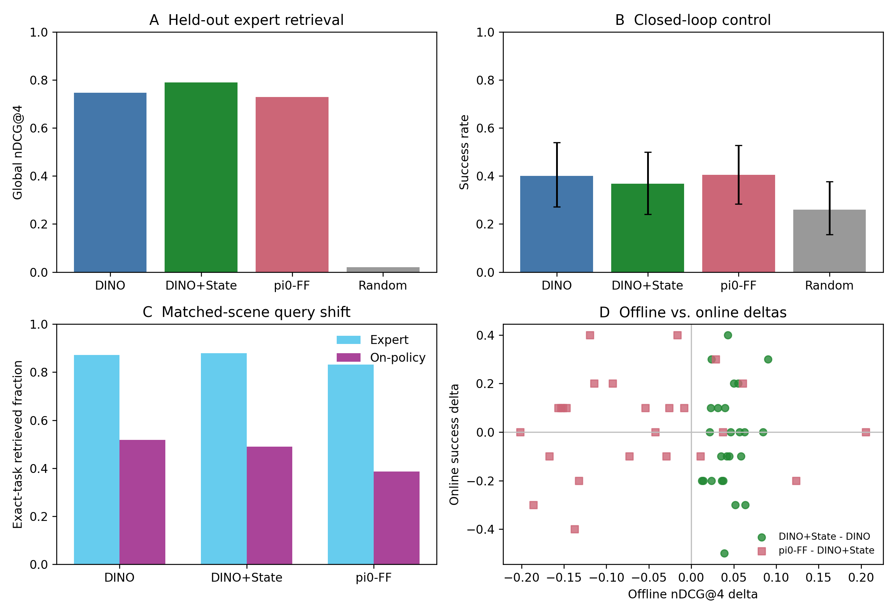

# When Does Retrieval Help? A Study of In-Context Adaptation in Vision-Language-Action Models

> **Paper:** [arXiv:2610.05492](https://arxiv.org/abs/2610.05492), NeurIPS 2026 Workshop PTA · Zixuan Liu, Joris Köster,
> Zizhan Zheng, Siavash Khajavi · This repository holds the code and results for the paper's LIBERO-90 experiments.

Retrieval-conditioned VLAs put retrieved demonstrations into the policy's context at every replanning step.
Retrievers are usually judged on held-out **expert** trajectories, but at deployment the queries come from the
policy's **own** trajectory. This repository fine-tunes a retrieval-conditioned pi0-FAST policy
([RICL](https://arxiv.org/abs/2508.02062)) on LIBERO-90 and audits whether offline retrieval quality predicts
closed-loop control.

**Finding:** it does not, for this policy. Adding robot state to DINOv2 retrieval clearly improves offline retrieval
(nDCG@4 0.746 → 0.790, better on 25/25 tasks), but in 1,000 paired rollouts the three informed retrievers reach
36.8–40.4% success with **statistically unresolved** differences. On the same task–scene pairs, retrieval of the
correct task drops from 83–88% on expert observations to 39–52% on policy-generated observations.



## Setup

- **Policy.** pi0-FAST fine-tuned for RICL-style context use on LIBERO-90 **tasks 0–19** (20 seeded demonstrations
  per task) from `pi0_fast_libero`, with four retrieved frames (image, state, action) in context and replanning every
  five environment steps. A matched non-retrieval baseline was trained on the same data
  (`pi0_fast_libero90_ricl` / `pi0_fast_libero90_normal` in [`config.py`](src/openpi/training/config.py)).
- **Tasks.** From the held-out tasks 20–69, the **baseline-RICL-capable subset** of 25 tasks: those where the DINO
  RICL policy succeeded at least once in a ten-rollout screen. The subset was frozen before any retriever comparison.
- **Memory.** One global memory with 20 demonstrations per task: 500 episodes, 69,990 candidate frames.
- **Offline audit.** 7,500 expert queries (30 held-out episodes × 10 frames × 25 tasks), disjoint from the memory.
- **Closed loop.** 25 tasks × 10 frozen scenes × 4 retrievers = **1,000 paired rollouts**, with scenes disjoint from
  memory and screening. Statistics use a task-hierarchical bootstrap (10,000 draws, seed 7) and exact McNemar tests
  with Holm correction.

Retrievers, used as probes rather than proposed methods:

| Name | Retrieval key |
|---|---|
| DINO | top-camera DINOv2 features, L2 (the selector the policy was trained with) |
| DINO+State | DINO distance + normalised proprioceptive-state distance, weight calibrated on tasks 0–19 |
| pi0-FF | pi0-FAST prefix-token representation after the first multimodal fusion block |
| Random | four frames sampled uniformly from the same memory (**random context**, not no context) |

## Results

### Offline: state improves expert-trajectory retrieval

| Method | Task-restricted best-of-4 action RMSE ↓ | Global nDCG@4 ↑ |
|---|---:|---:|
| DINO | 0.2253 | 0.7461 |
| DINO+State | **0.2083** | **0.7897** |
| pi0-FF | 0.2222 | 0.7280 |
| Random | 0.3738 | 0.0199 |

### Closed loop: the offline ranking does not carry over

| Method | Successes / 250 | Success | Task-hierarchical 95% CI |
|---|---:|---:|---:|
| DINO | 100 | 40.0% | [27.2, 54.0] |
| DINO+State | 92 | 36.8% | [24.0, 50.0] |
| pi0-FF | 101 | 40.4% | [28.4, 52.8] |
| Random | 65 | 26.0% | [15.6, 37.6] |

| Comparison | Difference | 95% CI | Holm-adjusted p |
|---|---:|---:|---:|
| DINO+State − DINO | −3.2 pp | [−13.2, 6.8] | 0.70 |
| pi0-FF − DINO+State | +3.6 pp | [−6.0, 13.6] | 0.70 |
| DINO − Random | +14.0 pp | [−0.4, 28.8] | 0.002 |
| DINO+State − Random | +10.8 pp | [−1.6, 23.6] | 0.008 |
| pi0-FF − Random | **+14.4 pp** | **[2.8, 26.0]** | **0.0002** |

The differences between informed retrievers are statistically unresolved. Under the paper's decision rule (CI above
zero *and* Holm p < 0.05), only pi0-FF is shown to beat random context. Offline nDCG does not predict per-task success
either (Spearman ρ between −0.21 and 0.02, all intervals cross zero).

### Why: retrieval shifts on the policy's own observations

Fraction of retrieved frames from the correct task, on the same 25 tasks and 250 scenes:

| Retriever | Expert trajectories | Policy trajectories | Drop | 95% CI |
|---|---:|---:|---:|---:|
| DINO | 87.2% | 51.8% | 35.4 pp | [23.8, 47.7] |
| DINO+State | 87.9% | 48.9% | 39.0 pp | [28.8, 50.1] |
| pi0-FF | 83.1% | 38.7% | 44.4 pp | [36.4, 52.4] |

Within tasks, successful rollouts keep higher correct-task retrieval over their first ten queries than failed ones
(+17.1, +23.4 and +12.9 pp; all CIs above zero). This is an association consistent with a retrieval–control feedback
loop, not a causal estimate. Correct-task identity is also an imperfect relevance label: on task 20 ("turn on the
stove"), DINO succeeds 10/10 while retrieving every frame from task 21, which contains the same subskill.

All tables and figures: [`results/`](results/) (closed loop and phase analysis),
[`results/offline_benchmark/`](results/offline_benchmark/README.md) (full offline audit, incl. wrist, prompt and
oracle variants), and [`results/early_findings/`](results/early_findings/README.md) (earlier RICL memory-size and
mismatched-context experiments).

## Limitations

- The policy was trained with DINO-selected context, so swapping the retriever at inference mixes retrieval quality
  with policy compatibility.
- Conclusions hold for the baseline-RICL-capable subset, not all of LIBERO-90. The last 15 tasks were run after part
  of the first batch was visible, with unchanged code and the full remaining set.
- Random context keeps the context format; there is no no-context control.
- Simulation only, one policy and one checkpoint.
- Correct-task metrics give zero credit to related tasks with transferable subskills.
- Distribution-shift and early-retrieval analyses are descriptive, not causal.
- DINO-distance action interpolation was disabled for all retrievers, so this is not exact vanilla RICL inference.

## What I built vs. upstream

This repository starts from [RICL](https://github.com/ricl-vla/ricl_openpi) (Sridhar et al.), which builds on
[openpi](https://github.com/Physical-Intelligence/openpi). Upstream's README is kept as
[RICL_DROID_README.md](RICL_DROID_README.md); see [NOTICE](NOTICE).

New in this repository:

| Area | Files |
|---|---|
| LIBERO RICL training data and retrieval | [`training/ricl_libero_dataset.py`](src/openpi/training/ricl_libero_dataset.py), [`scripts/setup_ricl_libero.py`](scripts/setup_ricl_libero.py), [`scripts/make_libero_retrieval_pool.py`](scripts/make_libero_retrieval_pool.py), [`policies/libero_dino_feature_cache.py`](src/openpi/policies/libero_dino_feature_cache.py) |
| Runtime retrieval during rollouts (DINO, DINO+State, pi0-FF, random) | [`policies/libero_runtime_retrieval.py`](src/openpi/policies/libero_runtime_retrieval.py), [`models/pi0_first_fusion.py`](src/openpi/models/pi0_first_fusion.py), [`scripts/check_pi_first_fusion_equivalence.py`](scripts/check_pi_first_fusion_equivalence.py) |
| Offline retrieval benchmark | [`policies/libero_retrieval_benchmark.py`](src/openpi/policies/libero_retrieval_benchmark.py), [`scripts/benchmark_libero90_retrieval.py`](scripts/benchmark_libero90_retrieval.py), [`scripts/benchmark_libero90_mixed_retrieval.py`](scripts/benchmark_libero90_mixed_retrieval.py) |
| Closed-loop study | frozen protocols [`libero90_final10_protocol.json`](scripts/libero90_final10_protocol.json) and [`libero90_extension15_protocol.json`](scripts/libero90_extension15_protocol.json), resumable runners [`run_libero90_final_retrieval.sh`](scripts/run_libero90_final_retrieval.sh) and [`run_libero90_extension15_retrieval.sh`](scripts/run_libero90_extension15_retrieval.sh) |
| Analysis | [`scripts/analyze_libero90_closed_loop_retrieval.py`](scripts/analyze_libero90_closed_loop_retrieval.py) (bootstrap, McNemar/Holm, figures), [`scripts/analyze_libero90_phase_retrieval.py`](scripts/analyze_libero90_phase_retrieval.py), [`scripts/build_libero90_reproducibility_manifest.py`](scripts/build_libero90_reproducibility_manifest.py) |
| Tests | 13 `*_test.py` files, e.g. for the dataset, runtime retrieval, benchmark and analysis; plus smoke checks in [`run_ricl_libero_quick_checks.sh`](scripts/run_ricl_libero_quick_checks.sh) |

Modified upstream files include `training/config.py` (LIBERO-90 RICL and baseline configs), `training/data_loader.py`,
`models/pi0_fast_ricl.py`, `policies/policy.py` and `examples/libero/` (LIBERO-90 conversion and evaluation client).
One-off scripts from earlier runs are in [`scripts/legacy/`](scripts/legacy/README.md).

## Checkpoints

- [`kugelblytz/pi0-fast-libero90-ricl-finetuned`](https://huggingface.co/kugelblytz/pi0-fast-libero90-ricl-finetuned): the RICL policy used in the study.
- [`kugelblytz/pi0-fast-libero90-normal-finetuned`](https://huggingface.co/kugelblytz/pi0-fast-libero90-normal-finetuned): the matched non-retrieval baseline.

_Both are currently private on Hugging Face._

## Reproducing

1. Install, convert LIBERO-90, build the RICL artifacts, train and serve: [docs/libero_ricl.md](docs/libero_ricl.md).
2. Offline audit: [`scripts/run_libero90_retrieval_benchmark.sh`](scripts/run_libero90_retrieval_benchmark.sh) and
   [`scripts/run_libero90_mixed_retrieval_benchmark.sh`](scripts/run_libero90_mixed_retrieval_benchmark.sh).
3. Closed loop and analysis: see [results/README.md](results/README.md#reproduce-the-evaluations).

Rollout videos (2,960 MP4s) are in a private Hugging Face dataset and are not part of this repository.

## License

Apache 2.0, as upstream. See [LICENSE](LICENSE) and [NOTICE](NOTICE).

## Citation

```bibtex
@inproceedings{liu2026whendoesretrievalhelp,
  title     = {When Does Retrieval Help? A Study of In-Context Adaptation in Vision-Language-Action Models},
  author    = {Liu, Zixuan and K{\"o}ster, Joris and Zheng, Zizhan and Khajavi, Siavash},
  booktitle = {NeurIPS 2026 Workshop PTA},
  year      = {2026},
  eprint    = {2610.05492},
  archivePrefix = {arXiv}
}
```
