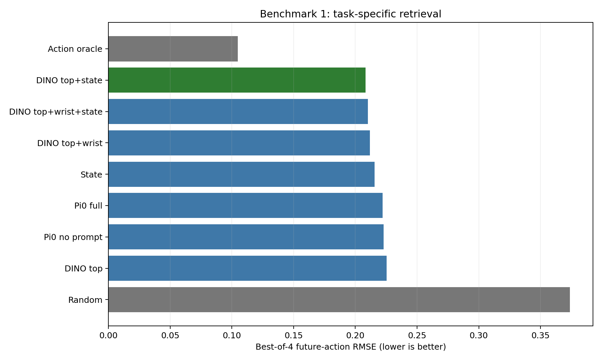
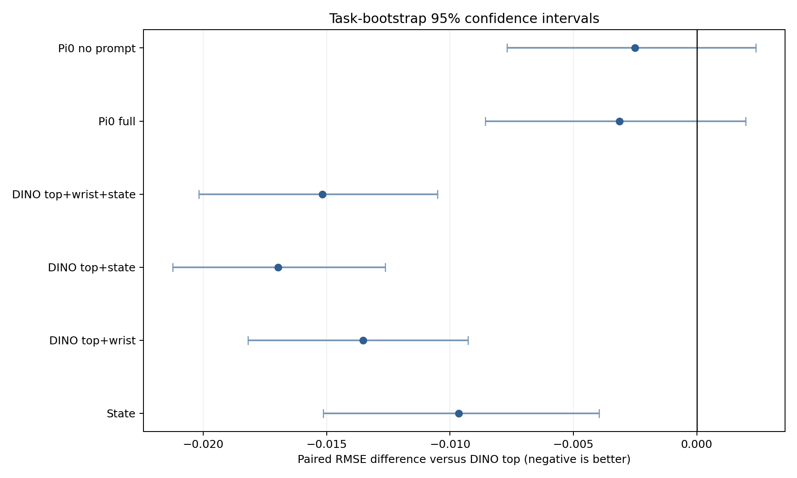
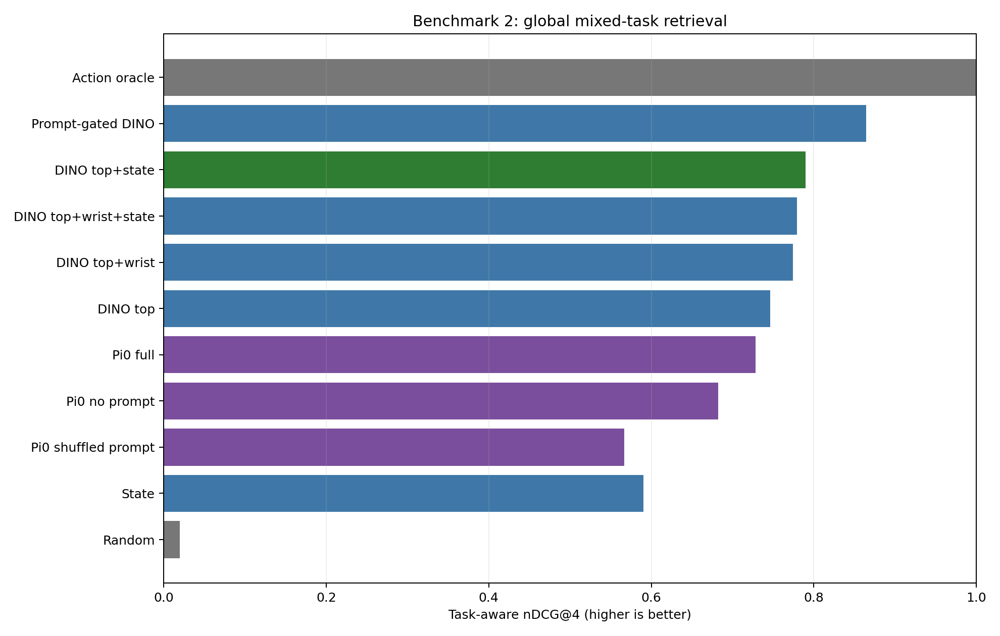
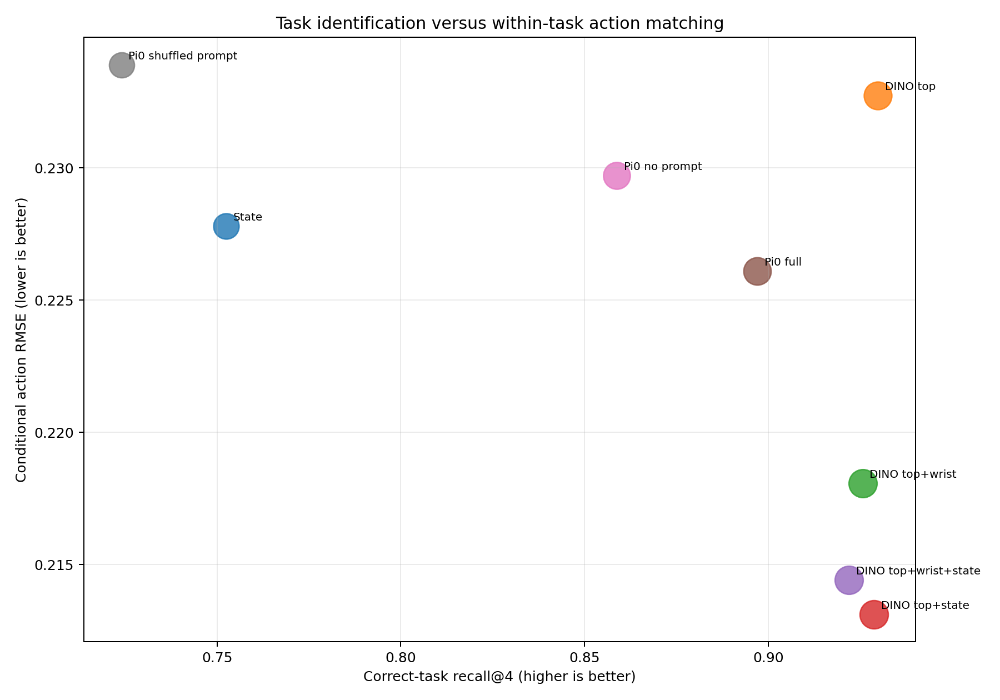
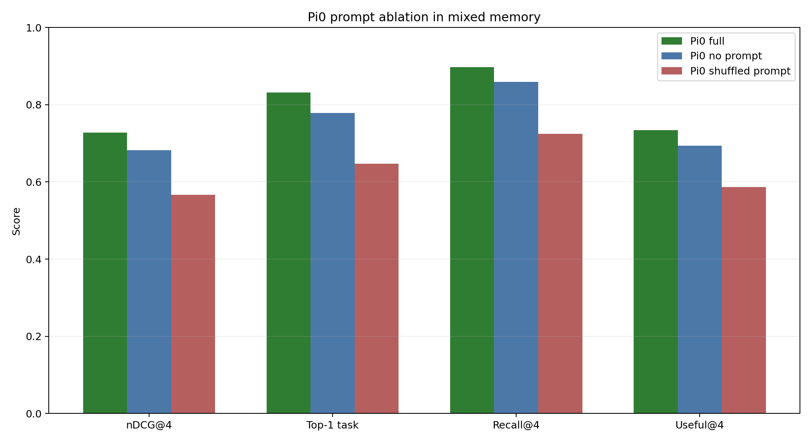
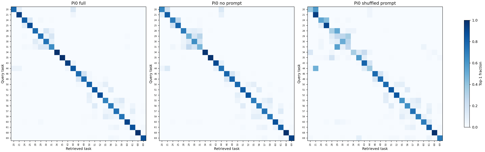
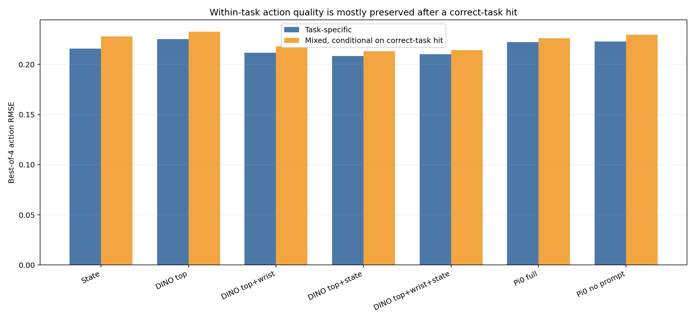
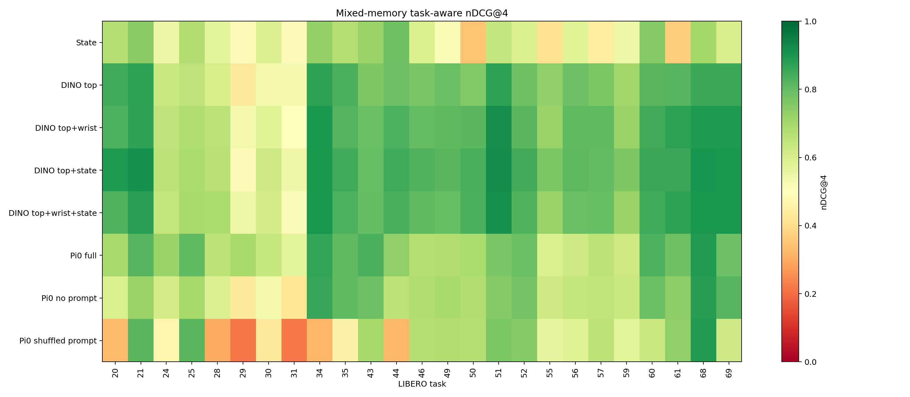

# LIBERO Retrieval Benchmarks: Combined Analysis

## Executive Summary

Two offline benchmarks were run over the same 25 LIBERO-90 tasks, 500 retrieval episodes, 69,990 candidate frames, and 7,500 held-out query frames.

1. The **task-specific benchmark** assumes the correct task is already known and measures how well each method retrieves the correct task phase or future action.
2. The **mixed-task benchmark** searches one global 25-task memory and therefore measures both task identification and within-task phase retrieval.

The central result is that **DINO top + robot state is the strongest general-purpose retriever in both settings**. In the task-specific benchmark it has the lowest practical action RMSE (`0.2083`), and in the mixed benchmark it has the highest ungated task-aware nDCG@4 (`0.7897`).

The prompt is genuinely useful to Pi0 when tasks are mixed. Pi0 full reaches `0.7280` nDCG, compared with `0.6821` without a prompt and `0.5664` with a deliberately wrong prompt. In contrast, prompt and no-prompt Pi0 were almost identical when retrieval was already restricted to one task.

A hard exact-prompt filter followed by DINO reaches `0.8643` nDCG and 100% task recall. This is a strong control, but it assumes candidate and query instructions use exactly matching text.

## What Was Held Constant

- Tasks: `20,21,24,25,28,29,30,31,34,35,43,44,46,49,50,51,52,55,56,57,59,60,61,68,69`
- Candidate memory: 20 episodes per task, 500 episodes total
- Candidate frames: 69,990
- Query split: 30 held-out episodes per task, with no candidate/query episode overlap
- Queries: 10 complete-horizon frames per held-out episode, 7,500 total
- Retrieval count: top four frames
- Action target: normalized next 10 expert actions
- Pi0 checkpoint: normal non-RICL `pi0_fast_libero90_normal` checkpoint
- Pi0 representation: first-block attention output at the last valid prefix token
- No policy inference, action generation, simulator execution, or RICL interpolation was run

## Experimental Protocol

### Candidate Memory

For every benchmark task, the candidate memory contains the same 20 seeded retrieval episodes used by the RICL20 evaluation. Every frame in those episodes is searchable, giving 500 candidate episodes and 69,990 candidate frames across the 25 tasks. A candidate frame contains a top-view image, wrist image, robot state, task prompt, episode/frame identity, normalized trajectory progress, and its next 10 expert actions.

All candidate frames are retained to match actual RICL memory lookup. When fewer than 10 future actions remain near the end of a candidate episode, the final available action is repeated to complete the scoring chunk. Held-out query frames, by contrast, are selected only where 10 real future actions remain.

The future actions are retained only as hidden evaluation labels. They are not supplied to DINO, state, Pi0, prompt-gated, or task-gated retrieval.

### Held-Out Queries

The 30 episodes per task absent from the retrieval memory form the held-out query set. Ten frames are selected at evenly spaced trajectory positions from each held-out episode. Query frames must have a complete 10-step future action chunk. This produces `30 x 10 = 300` queries per task and `7,500` queries in total.

Candidate and query episode IDs are explicitly checked for overlap. The benchmark therefore measures retrieval into separate demonstrations, not recovery of another frame from the query episode.

### Two Search Conditions

1. **Task-specific:** a query searches only candidate frames from its own task. This isolates trajectory-phase and action matching after the task has already been identified.
2. **Mixed-task:** a query searches one global index containing all 69,990 frames from all 25 tasks. Unless a method is explicitly called gated, it receives no numeric task ID. This tests task identification and within-task phase matching together.

All methods return exactly four frames. Distance ties are resolved deterministically by `(distance, episode_index, frame_index)` in the task-specific benchmark and `(distance, task_index, episode_index, frame_index)` in the mixed benchmark.

## Exact Retrieval Methods

The table summarizes what each method may inspect. A check means the information affects retrieval; expert actions are available only to the reporting oracle.

| Method | Top image | Wrist image | State | Prompt | Task ID | Future actions |
|---|:---:|:---:|:---:|:---:|:---:|:---:|
| Random |  |  |  |  |  |  |
| State |  |  | ✓ |  |  |  |
| DINO top | ✓ |  |  |  |  |  |
| DINO top+wrist | ✓ | ✓ |  |  |  |  |
| DINO top+state | ✓ |  | ✓ |  |  |  |
| DINO top+wrist+state | ✓ | ✓ | ✓ |  |  |  |
| Pi0 full | ✓ | ✓ | ✓ | ✓ |  |  |
| Pi0 no prompt | ✓ | ✓ | ✓ | blank |  |  |
| Pi0 shuffled prompt | ✓ | ✓ | ✓ | wrong |  |  |
| Prompt-gated DINO | ✓ |  |  | exact filter |  |  |
| Task-gated DINO | ✓ |  |  |  | ✓ |  |
| Action oracle |  |  |  |  | ✓ | ✓ |

### Random

Random retrieval samples four distinct candidate frames without replacement. Each query is evaluated with 20 deterministic seeded repeats and the metrics are averaged. It supplies a chance-level lower bound. In the task-specific benchmark it samples within the query task; in the mixed benchmark it samples from the complete 25-task memory.

### State

The 8-dimensional LIBERO robot state is standardized with the normal checkpoint statistics:

```text
normalized_state = (state - checkpoint_mean) / (checkpoint_std + 1e-6)
distance = L2(query_normalized_state, candidate_normalized_state)
```

This method has no visual or language information. It retrieves configurations with similar end-effector, gripper, and proprioceptive state, which often acts as a proxy for trajectory phase.

### DINO Top

The top-view RGB image is resized with padding to `224x224`, scaled to `[0,1]`, and normalized with ImageNet mean and standard deviation. It is passed through frozen `dinov2_vitb14`. The model's `16x16 = 256` normalized patch tokens are spatially pooled in non-overlapping `2x2` groups, producing an `8x8` grid of 64 vectors. Each vector has 768 dimensions, and the grid is flattened into one `64x768 = 49,152` dimensional feature.

Candidate frames are ranked by Euclidean distance between these flattened spatial features. Retaining the 8x8 layout preserves coarse object location better than using only the DINO CLS token or a global average.

### DINO Top+Wrist

The same frozen DINO pipeline independently embeds the top and wrist images. The combined distance is:

```text
distance = sqrt(top_L2_squared + wrist_L2_squared)
```

This is equivalent to concatenating the two 49,152-dimensional features and taking Euclidean distance. It adds close-range gripper and held-object evidence while preserving the top-view scene.

### DINO Top+State

DINO top distance and normalized-state distance have different numerical scales, so each query's candidate distance vector is divided by its own median before combination:

```text
distance = dino_top / median(dino_top) + beta * state / median(state)
```

The tested beta grid was `0, 0.1, 0.25, 0.5, 1, 2`. Calibration used only tasks `0-19`, never benchmark tasks `20-69`. The selected value was `beta=1.0`, minimizing macro-average best-of-four action RMSE on calibration tasks.

### DINO Top+Wrist+State

This method first forms the joint top+wrist DINO distance, then combines it with state using the same per-query median scaling:

```text
distance = dino_top_wrist / median(dino_top_wrist) + beta * state / median(state)
```

The independently calibrated value was `beta=0.5`.

### Pi0 Full

This method uses the normal, non-RICL checkpoint `pi0_fast_libero90_normal`. Each frame is passed through the normal Pi0-FAST preprocessing path with exactly these observation fields:

```text
observation/image
observation/wrist_image
observation/state
prompt
```

The checkpoint normalization is applied first. Pi0's SigLIP `So400m/14` image encoder converts both images to image tokens. The normal FAST tokenizer encodes the prompt together with the normalized state. No action tokens, retrieved demonstrations, RICL input structure, distances, or interpolation values are supplied.

The image tokens and prompt/state tokens form one prefix. The retrieval feature is the 2,048-dimensional output projection of transformer block 1 self-attention at the last valid prefix token. This is the earliest single token that has attended across the complete image-and-text/state prefix. It is captured before block 1's residual addition, feed-forward network, and all later transformer blocks, then L2-normalized. Retrieval uses Euclidean distance between these normalized features.

### Pi0 No Prompt

This is identical to Pi0 full, including the same checkpoint, images, state, normalization, FAST tokenizer, feature location, and ranking. The only change is replacing the instruction with an empty string for both candidate and query frames. State remains present in the FAST token sequence. The comparison therefore isolates the information contributed by task language.

### Pi0 Shuffled Prompt

This mixed-task-only diagnostic leaves candidate embeddings unchanged with their correct prompts. Each query is re-embedded with a deterministic prompt borrowed from a different task, explicitly chosen to have different text. Its images and state remain correct. A performance drop shows that the Pi0 representation uses prompt semantics rather than merely tolerating the prompt tokens.

### Prompt-Gated DINO

This mixed-task control first keeps only candidate frames whose prompt string exactly equals the query prompt, then ranks that eligible set with DINO top distance. It does not receive the numeric task ID. If two tasks share identical text, both remain eligible. In this benchmark, DINO's visual ranking disambiguated those remaining cases, yielding 100% correct-task recall.

This is exact string matching, not a language embedding or semantic paraphrase matcher.

### Task-Gated DINO

This reporting control uses the known numeric task ID to restrict candidates to the correct task and then applies DINO top retrieval. It reproduces the original task-specific DINO selections exactly. It represents performance when task identification is perfect, but it is not an ungated mixed-memory retriever.

### Action Oracle

The oracle ranks candidates by RMSE between the candidate's and query's next 10 expert actions after checkpoint quantile normalization:

```text
normalized_action = 2 * (action - q01) / (q99 - q01 + 1e-6) - 1
distance = RMSE(candidate_action[10,7], query_action[10,7])
```

In mixed retrieval, the oracle is also restricted to the correct task. It is a reporting-only upper bound and cannot be used at deployment because future query actions are unknown.

## Scoring and Aggregation

### Task-Specific Metrics

- **Top-1 action RMSE:** action error of the nearest retrieved frame.
- **Best-of-4 action RMSE:** lowest action error among the four retrieved frames; this is the primary metric.
- **Mean top-4 action RMSE:** average action error across all four frames.
- **Oracle regret:** best-of-four RMSE minus the lowest possible same-task action RMSE.
- **Progress error:** mean absolute difference in normalized trajectory position.
- **State error:** mean normalized-state L2 error of the four retrieved frames.
- **Unique episodes:** number of distinct demonstrations represented among the top four.

### Mixed-Task Metrics

- **Top-1 task accuracy:** whether the nearest frame belongs to the query task.
- **Task recall@4:** whether at least one of the four frames belongs to the query task.
- **Correct-task fraction@4:** fraction of the four frames belonging to the query task.
- **Useful retrieval@4:** whether at least one correct-task frame falls in the best 10% of same-task candidates by future-action RMSE.
- **Conditional action RMSE:** best action RMSE among correct-task hits, reported only when at least one exists.
- **Task-aware nDCG@4:** the primary mixed metric. Wrong-task frames receive zero relevance. A correct-task frame's relevance is its percentile rank among all same-task candidates by future-action RMSE. Rank positions are discounted by `1/log2(rank+1)` and normalized by the ideal action-oracle ordering.

Each metric is first averaged over the 300 queries within a task. The reported overall score then averages the 25 task means equally, preventing longer candidate episodes or particular tasks from dominating. Pairwise confidence intervals use a seeded 10,000-sample bootstrap over tasks.

## Validation and Execution Guards

Before the full task-specific benchmark, a CUDA smoke test ran every method on tasks `20` and `30`, which cover both retrieval-artifact families. It used all 20 candidate episodes, the lowest-numbered held-out episode, and three evenly spaced query frames per task. The mixed benchmark repeated this smoke structure against the global index.

The implementation checked that:

- CUDA was used for both DINO and Pi0 feature extraction.
- Every method returned exactly four candidates.
- Candidate and query episodes never overlapped.
- Task-specific candidates always belonged to the query task.
- Pi0 observation dictionaries contained no expert actions or RICL demonstrations.
- Correct-prompt and blank-prompt token sequences differed.
- Shuffled prompts differed from the corresponding correct prompts.
- Feature arrays and distance vectors contained no NaNs or infinities.
- Repeated ranking calls produced identical candidate orderings.
- Hybrid calibration read only tasks `0-19`.
- Task-gated mixed DINO matched all 7,500 original task-specific DINO selections.

Both full manifests are marked `complete`. The final task-specific file contains 67,500 rows (`7,500 queries x 9 methods`), and the mixed-task file contains 90,000 rows (`7,500 queries x 12 methods`).

## Benchmark 1: Task-Specific Retrieval

Every query searched only the 20 retrieval episodes belonging to its known task. The main metric is **best-of-four action RMSE**, where lower is better.



### Overall Results

| Rank | Method | Best-of-4 RMSE | Relative to DINO top | Random-to-oracle gap closed |
|---:|---|---:|---:|---:|
| 1 | Action oracle | 0.1047 | +53.5% | 100.0% |
| 2 | DINO top+state | 0.2083 | +7.5% | 61.5% |
| 3 | DINO top+wrist+state | 0.2101 | +6.7% | 60.8% |
| 4 | DINO top+wrist | 0.2118 | +6.0% | 60.2% |
| 5 | State | 0.2156 | +4.3% | 58.8% |
| 6 | Pi0 full | 0.2222 | +1.4% | 56.3% |
| 7 | Pi0 no prompt | 0.2228 | +1.1% | 56.1% |
| 8 | DINO top | 0.2253 | +0.0% | 55.2% |
| 9 | Random | 0.3738 | -65.9% | 0.0% |

DINO top+state improves action RMSE by **7.5%** over DINO top-only and closes **61.5%** of the random-to-oracle gap. DINO top+wrist and DINO top+wrist+state are close behind.

State alone also beats DINO top-only, showing that robot configuration contains substantial task-phase information. However, combining state with vision is better than either alone.

Pi0 full and Pi0 without prompt improve only slightly over DINO top-only. Their paired task-bootstrap confidence intervals cross zero, so this benchmark does not establish a reliable Pi0 advantage over top-view DINO.



### Consistency Across Tasks

- DINO top+state beats DINO top on 22 of 25 tasks.
- DINO top+wrist beats DINO top on 23 of 25 tasks.
- DINO top+wrist+state beats DINO top on 22 of 25 tasks.
- Pi0 full beats DINO top on 12 tasks and loses on 13.
- DINO top+state is the best practical method on 13 tasks; DINO top+wrist+state wins 6.

Exact frame overlap with the action oracle is low for every practical method. This is expected: multiple demonstration frames can encode nearly equivalent future motions. Action RMSE and oracle regret are more meaningful than exact frame identity.

## Benchmark 2: Global Mixed-Task Retrieval

Each query searched all 69,990 frames from all 25 tasks. Global methods did not receive the numeric task ID. The primary metric is **task-aware nDCG@4**, where wrong-task frames receive zero relevance and correct-task frames are graded by their percentile among same-task action matches.



### Overall Results

| Rank | Method | nDCG@4 | Top-1 task | Task recall@4 | Useful retrieval@4 |
|---:|---|---:|---:|---:|---:|
| 1 | Action oracle | 1.0000 | 100.0% | 100.0% | 100.0% |
| 2 | Prompt-gated DINO | 0.8643 | 100.0% | 100.0% | 84.2% |
| 3 | Task-gated DINO | 0.8643 | 100.0% | 100.0% | 84.2% |
| 4 | DINO top+state | 0.7897 | 87.4% | 92.9% | 80.2% |
| 5 | DINO top+wrist+state | 0.7792 | 86.9% | 92.2% | 78.9% |
| 6 | DINO top+wrist | 0.7742 | 87.1% | 92.6% | 78.6% |
| 7 | DINO top | 0.7461 | 86.9% | 93.0% | 76.8% |
| 8 | Pi0 full | 0.7280 | 83.2% | 89.7% | 73.4% |
| 9 | Pi0 no prompt | 0.6821 | 77.8% | 85.9% | 69.4% |
| 10 | State | 0.5902 | 66.0% | 75.2% | 61.7% |
| 11 | Pi0 shuffled prompt | 0.5664 | 64.8% | 72.4% | 58.7% |
| 12 | Random | 0.0199 | 4.1% | 14.9% | 1.5% |

Among ungated methods, DINO top+state is best. It improves nDCG by `0.0436` over DINO top-only, with a paired 95% CI of `[0.0364, 0.0511]`, and wins on all 25 tasks.

The state term barely changes task recall, but materially improves nDCG and useful retrieval rate. This means state primarily helps choose the correct **phase** within candidate tasks rather than identify the task.



## Prompt Analysis



- Pi0 full versus blank prompt: `+0.0459` nDCG, `+5.3` percentage points in top-1 task accuracy, and `+3.8` percentage points in recall@4.
- Pi0 full versus wrong prompt: `+0.1616` nDCG, `+18.4` percentage points in top-1 task accuracy, and `+17.3` percentage points in recall@4.
- Full beats blank on 18 of 25 tasks; paired nDCG 95% CI `[0.0221, 0.0727]`.
- Full beats wrong-prompt retrieval on 20 of 25 tasks; paired 95% CI `[0.0973, 0.2312]`.

This is the cleanest evidence that the early Pi0 representation actually contains and uses language. The effect was hidden in the first benchmark because every candidate within a task had essentially the same instruction.



Prompt-gated DINO first filters candidates by exact instruction text and then ranks them visually. It matches task-gated DINO in aggregate. Even where prompts are duplicated across tasks, DINO resolves the remaining scene differences in this dataset.

## Separating Task Selection from Phase Retrieval



For queries where a mixed-memory method retrieves at least one correct-task frame, its conditional action RMSE remains close to its task-specific RMSE:

| Method | Same-task RMSE | Mixed conditional RMSE | Relative change | Mixed task recall@4 |
|---|---:|---:|---:|---:|
| State | 0.2156 | 0.2278 | +5.6% | 75.2% |
| DINO top | 0.2253 | 0.2327 | +3.3% | 93.0% |
| DINO top+wrist | 0.2118 | 0.2181 | +3.0% | 92.6% |
| DINO top+state | 0.2083 | 0.2131 | +2.3% | 92.9% |
| DINO top+wrist+state | 0.2101 | 0.2144 | +2.0% | 92.2% |
| Pi0 full | 0.2222 | 0.2261 | +1.8% | 89.7% |
| Pi0 no prompt | 0.2228 | 0.2297 | +3.1% | 85.9% |

The conditional increases are generally only about 2-6%. This suggests that most global-index degradation comes from selecting the wrong task or diluting the top four with wrong-task frames, rather than losing the ability to identify useful phases once the correct task is reached.

Conditional RMSE must be interpreted alongside recall because it excludes queries with no correct-task hit.

## Per-Task Patterns



DINO top+state is the best ungated method on 15 of 25 tasks. Pi0 full wins five tasks, especially several visually ambiguous cabinet and container tasks.

### Hardest Tasks for DINO Top+State

| Task | Instruction | nDCG | Top-1 task | Recall@4 |
|---:|---|---:|---:|---:|
| 29 | put the black bowl in the top drawer of the cabinet | 0.487 | 53.3% | 71.0% |
| 31 | put the black bowl on top of the cabinet | 0.542 | 57.3% | 72.3% |
| 30 | put the black bowl on the plate | 0.624 | 69.3% | 81.7% |
| 24 | put the black bowl in the bottom drawer of the cabinet | 0.655 | 75.0% | 84.7% |
| 28 | close the top drawer of the cabinet | 0.661 | 75.0% | 84.3% |

### Hardest Tasks for Pi0 Full

| Task | Instruction | nDCG | Top-1 task | Recall@4 |
|---:|---|---:|---:|---:|
| 31 | put the black bowl on top of the cabinet | 0.571 | 64.7% | 76.7% |
| 55 | pick up the alphabet soup and put it in the tray | 0.597 | 68.0% | 79.3% |
| 56 | pick up the butter and put it in the tray | 0.623 | 71.3% | 83.7% |
| 59 | pick up the tomato sauce and put it in the tray | 0.627 | 73.7% | 83.0% |
| 30 | put the black bowl on the plate | 0.635 | 74.0% | 83.7% |

The most frequent DINO confusions occur among visually similar cabinet/bowl tasks:

`29→31` (88), `25→24` (78), `24→25` (75), `31→29` (72), `31→30` (45).

Pi0's most frequent confusions include both visual and instruction-related pairs:

`46→49` (57), `29→31` (49), `28→30` (48), `49→46` (47), `20→44` (43).

## Practical Interpretation

1. **Known task or exact prompt:** use a prompt/task filter first, then retrieve phase using DINO+state. The exact combination prompt-gated DINO+state was not directly scored, but the two benchmarks strongly motivate testing it next.
2. **Unknown task without reliable text matching:** DINO top+state is the safest current choice.
3. **Learned multimodal retrieval:** Pi0 full clearly uses prompt information, but its early-fusion embedding does not outperform DINO+state overall.
4. **Wrist image:** wrist features help consistently, but state supplies a slightly stronger and cheaper gain.

## Limitations

- These are offline retrieval benchmarks, not policy-success evaluations.
- Future expert actions are used only for scoring and the reporting-only oracle.
- The 25 tasks were selected because at least one prior policy succeeded on them; results may be optimistic relative to all LIBERO-90 tasks.
- Mixed retrieval covers 25 tasks, not a full 90-task memory.
- Prompt gating requires exact prompt equality and has not been tested against paraphrases or noisy language.
- Conditional action RMSE excludes queries without a correct-task retrieval.
- Pi0 uses the earliest fused prefix representation, not a later semantic or action-conditioned layer.
- Cached retrieval latency does not include one-time feature extraction.

## Reproducibility

- Normal config: `pi0_fast_libero90_normal`
- Normal checkpoint: `checkpoints/pi0_fast_libero90_normal/libero90_train20x20_normal/9999`
- Source datasets: `local/libero90_official20to29`, `local/libero90_official30to69`
- Retrieval memory for tasks 20-29: `ricl_libero_preprocessing/libero90_official20to29_spread20/retrieval`
- Retrieval memory for tasks 30-69: `ricl_libero_preprocessing/libero90_official30to69_leftout10_seeded20/retrieval`
- Hybrid calibration: `data/libero/retrieval_benchmark/libero90_solvable25_offline_v1/calibration.json`
- Shuffled-prompt assignment: `data/libero/retrieval_benchmark/libero90_solvable25_mixed_global_v1/shuffled_prompt_map_full.json`
- Task-specific manifest: `data/libero/retrieval_benchmark/libero90_solvable25_offline_v1/manifest.json`
- Mixed-task manifest: `data/libero/retrieval_benchmark/libero90_solvable25_mixed_global_v1/manifest.json`
- Task-specific detailed results: `data/libero/retrieval_benchmark/libero90_solvable25_offline_v1/full/queries.jsonl`
- Mixed-task detailed results: `data/libero/retrieval_benchmark/libero90_solvable25_mixed_global_v1/full/queries.jsonl`
- Task-specific report: `data/libero/reports/libero90_solvable25_offline_v1.xlsx`
- Mixed-task report: `data/libero/reports/libero90_solvable25_mixed_global_v1.xlsx`
- Task-specific command: `JAX_PLATFORMS=cuda OPENPI_POLICY_FLOAT32_FOR_CUDA=1 MODE=all scripts/run_libero90_retrieval_benchmark.sh`
- Mixed-task command: `JAX_PLATFORMS=cuda OPENPI_POLICY_FLOAT32_FOR_CUDA=1 MODE=all scripts/run_libero90_mixed_retrieval_benchmark.sh`
- Combined analysis generator: `scripts/export_libero90_retrieval_combined_analysis.py`

The manifests record the checkpoint identity hashes, dataset metadata hashes, package versions, CUDA device, git commit, working-tree diff, cache sizes, and exact output paths.

## Appendix: Included Task Prompts

These are the exact prompt strings stored in the benchmark results. Tasks `20` and `44`, tasks `25` and `31`, and tasks `46` and `50` intentionally share prompt text. That duplication is why prompt gating is not equivalent in principle to task-ID gating.

| Task ID | Exact prompt |
|---:|---|
| 20 | turn on the stove |
| 21 | turn on the stove and put the frying pan on it |
| 24 | put the black bowl in the bottom drawer of the cabinet |
| 25 | put the black bowl on top of the cabinet |
| 28 | close the top drawer of the cabinet |
| 29 | put the black bowl in the top drawer of the cabinet |
| 30 | put the black bowl on the plate |
| 31 | put the black bowl on top of the cabinet |
| 34 | put the yellow and white mug to the front of the white mug |
| 35 | open the microwave |
| 43 | put the white bowl on top of the cabinet |
| 44 | turn on the stove |
| 46 | pick up the alphabet soup and put it in the basket |
| 49 | pick up the tomato sauce and put it in the basket |
| 50 | pick up the alphabet soup and put it in the basket |
| 51 | pick up the butter and put it in the basket |
| 52 | pick up the milk and put it in the basket |
| 55 | pick up the alphabet soup and put it in the tray |
| 56 | pick up the butter and put it in the tray |
| 57 | pick up the cream cheese and put it in the tray |
| 59 | pick up the tomato sauce and put it in the tray |
| 60 | pick up the black bowl on the left and put it in the tray |
| 61 | pick up the chocolate pudding and put it in the tray |
| 68 | put the yellow and white mug on the right plate |
| 69 | put the chocolate pudding to the left of the plate |